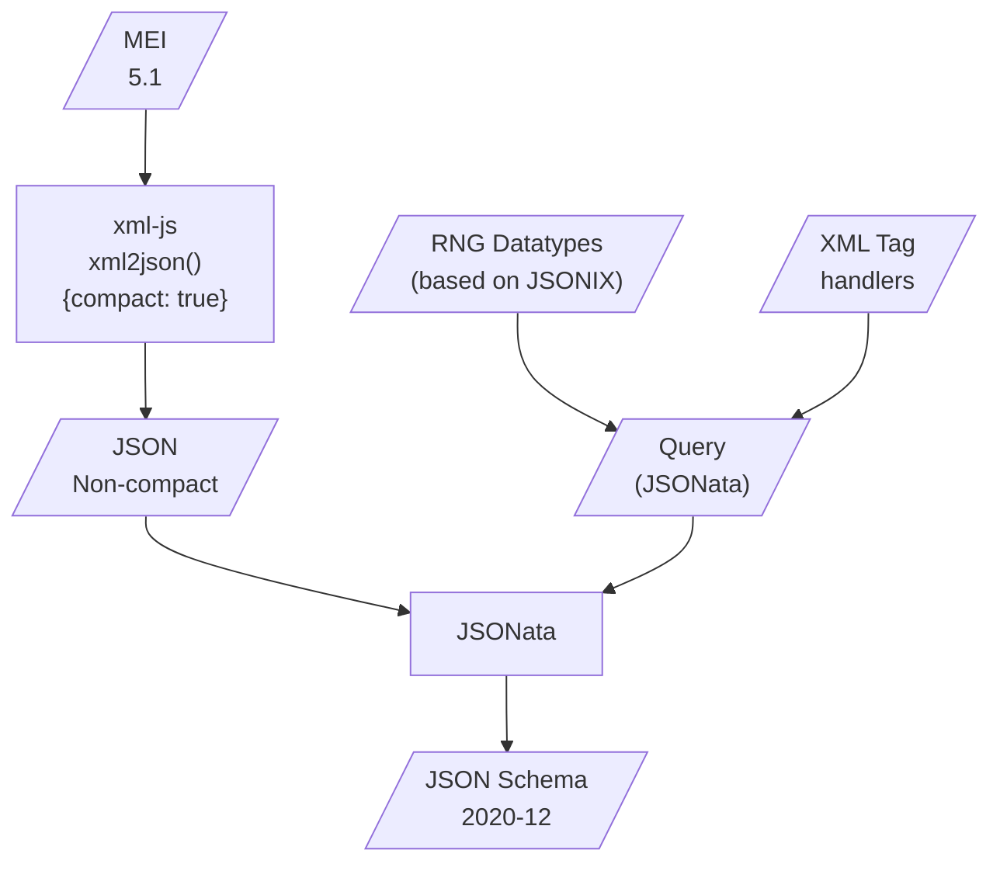

# `MEI.odd` → `JSON Schema`

This repository presents a pipeline allowing for effective translation of MEI 5.1 specification into JSON Schema 2020-12 using JSONata.

## Rationale

MEI is a specification for encoding music documents as XML.

We would like to benefit from the MEI's rigidity when building music document-oriented web functionalities.

JSON Schema is an ideal candidate for an entry point to MEI specs. It is widely accepted in the role of a Single-Source-Of-Truth and integrates well with the widely used validators (API's, schemas) and DX-enhancements (Typescript types, linters).

Additionally, JSON Schema allows various forms of annotations (title, descriptions, comments etc). They allow to carry MEI documentation strings.

The goal of this project is not to validate MEI documents using JSON Schema. It it to provide JSON Schema whose part can be consumed by client when building their MEI-oriented functionalities. For example, we would like to have a child class of `Node` representing a \"Music Note\" that understands what kind of arguments are allowed. This may lead to an MEI-based API for creating music scores: a MEI-first spec- and DOM-based alternative to the more common object-oriented paradigms like `Music21j`.

```js
const note = new Note(/* pitch as /[A-G]/ */)
note.accid = 's'

// Create MEI templates!
const chord = new Chord()
chord.append(note)
chord.append(note.copy().transpose(/* ... */))
```

Of course, a full conversion to JSON Schema is not possible. It won't be possible to e.g. preserve MEI validators of node's order. However, all value and enum-like specs should suffice to enhance DX when working with MEI document gneeration/templating.

## Pipeline



We start with the MEI-all specification.
> [!caution]
> Is it a good entry point to MEI spec?

```xml
<!-- fragment of mei-all_compiled.odd -->
<macroSpec rend="add" ident="data.ACCIDENTAL.WRITTEN" module="MEI" type="dt">
  <desc xmlns:xi="http://www.w3.org/2001/XInclude" xml:lang="en">
    Written accidental values.
  </desc>
  ...
</macroSpec>
```

The main decision to take is when to switch the format from XML to JSON. We took approach to do it _as early as possible_ in our pipeline and _avoid XML tech stack_, because our end-goal is webdev-suiting specification, not document manipulation. This means that all the queries and transformations will be applied to the intermediate representation already in JSON. 

> [!note]
> Michael Kay, the founder of  *`Saxonica`*, [acknowledges](https://www.saxonica.com/papers/xmlprague-2016mhk.pdf) merits of JSON over XML:
> * simpler grammar,
> * data model following  e.g. Javascript,
> * better web support.

The main steps are:

### 1) Converting MEI.odd to *non-compact* JSON using [`xml-js`](https://github.com/nashwaan/xml-js).

The *non-compact* JSON conversion preserves all XML nodes and – unlike most \"compact\" formats – their order. More info [here](https://github.com/nashwaan/xml-js#compact-vs-non-compact).

```json
// The same fragment, but in non-compact JSON, converted using `xml-js`.
{
  "type": "element",
  "name": "macroSpec",
  "attributes": {
    "rend": "add",
    "ident": "data.ACCIDENTAL.WRITTEN",
    "module": "MEI",
    "type": "dt"
  },
  "elements": [
    {
      "type": "element",
      "name": "desc",
      "attributes": {
        "xmlns:xi": "http://www.w3.org/2001/XInclude",
        "xml:lang": "en"
      },
      "elements": [ ... ]
    },
    ...
  ],
},
```

### 2) Transforming JSON using JSONata

Although `xml-js` allows to use Custom Processing Functions on given XML nodes, we adhere to [JSONata](https://github.com/jsonata-js/jsonata). It is a query language for JSON allowing complex queries, local variable definitions and function-paradigm workflow.

The main power of JSONata lies in the fact, that we can define queries using JSON:

```h
// Handle tag resulting in an object schema.
$handleAttrs := $handleSome(?, ["attList"],
  function($el) {
    {
      "properties": $el ~> $handleChildren("attList"),
      "required": ($el.* ~> $elem("attDef"))[usage="req"].ident
    }
  }
);
```

In our query we define:
* helper routines for traversing non-compact JSON,
* XML tag handlers,
* RNG datatype handlers
* _TO DO: Schematron handlers_

If an unknown tag is encountered (that does not have a handler), an error is thrown.


### Typescript?

Future work:

Typescript files can be derived from
1) the resulting JSON Schema
2) another JSONata query.
